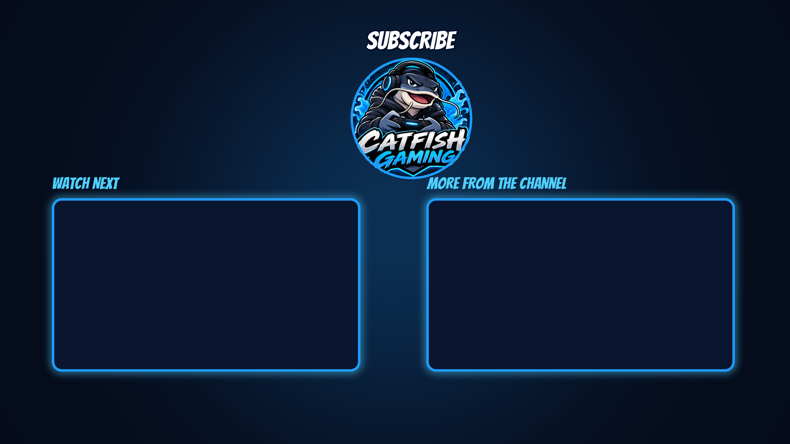
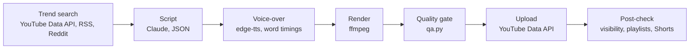
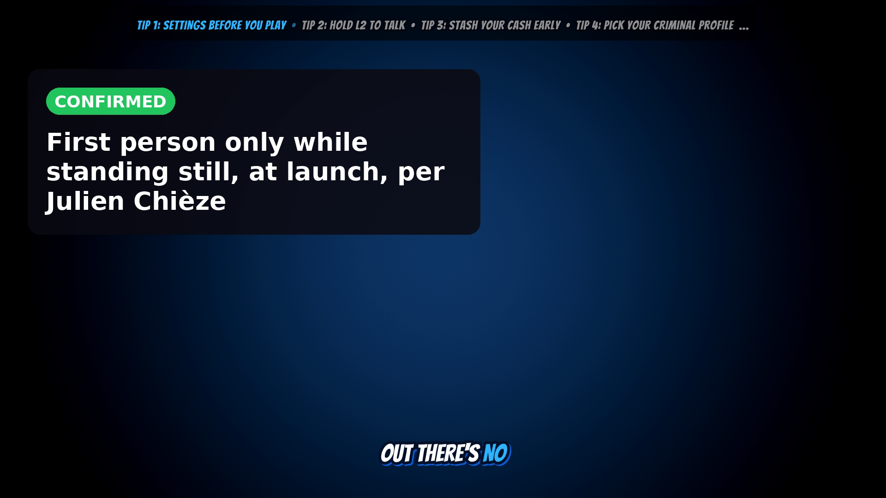

# Content Bot: automated YouTube videos for Catfish Gaming

A Python 3.12 bot that writes, voices, edits and uploads gaming news and tips videos for the YouTube channel
**[Catfish Gaming (@catfishgaminghd)](https://www.youtube.com/@catfishgaminghd)**. It covers GTA 6 right now.
It runs in Docker on a daily schedule and makes each video from start to finish without manual editing.



## What it does

Each run follows this pipeline:



1. **Trend search** (`trending.py`, `research.py`, `news.py`). The bot ranks recent GTA 6 videos by views per
   hour, engagement and an outlier factor. It also reads RSS feeds from about ten gaming news sites, fetches the
   full article text and collects Reddit topic signals.
2. **Script** (`scriptwriter.py`, `clean.py`). Claude writes a structured JSON script of about 2,400 words. The
   script holds the chapters, CONFIRMED / RUMOR / LEAK / MY TAKE cards, title, description, tags, thumbnail text and
   separate Hook-Progression-Climax scripts for Shorts. A profanity filter checks it, and the bot retries once if
   it fails.
3. **Voice-over** (`tts.py`). edge-tts makes the narration with word-level timings. ElevenLabs and Piper are
   optional engines.
4. **Render** (`render.py`, `cards.py`, `panels.py`, `brand.py`, `music.py`, `footage.py`):
   - captions of at most three words, with the spoken word highlighted
   - a topic bar at the top that highlights the current chapter
   - news panels and fact cards
   - background footage picked per topic from a tagged scene index, with no repeats
   - intro, endscreen, background music with loudness normalisation (LUFS), and sound effects on chapter changes
5. **Quality gate** (`qa.py`, `preflight.py`). With ffprobe and ffmpeg it checks length, audio levels, and black or
   frozen frames. It also checks the title, thumbnails and script before anything is uploaded. If the gate fails,
   nothing is uploaded. A clip with black frames is cut again from a new spot.
6. **Upload** (`uploader.py`, `playlists.py`, `shorts.py`, `thumbnail.py`). The bot uploads with resumable
   upload, sets the thumbnail and adds the video to a playlist (news or guides). It also posts vertical Shorts
   that link to the newest long video.
7. **Schedule** (`scheduler.py`, Docker). The container runs daily jobs one after another. It writes a heartbeat
   file that the Docker health check reads.



## Reliability

The bot runs unattended, so most of the code handles failure:

- **Timeouts** for every external process (ffmpeg, TTS, yt-dlp) and API call (`proc.py`).
- **Retries.** Upload chunks are retried on 5xx and connection errors. A failed job gets up to two more tries
  and keeps the same script.
- **Stuck video repair.** If YouTube processing hangs or rejects a video, the bot uploads it again once and
  links the new copy (`test_relink_stuck.py`).
- **Post-check.** After upload, the bot reads the video's status back. If the video did not go public, it sends
  an alert to a Discord or Slack webhook (`alerts.py`).
- **Interrupted uploads resume** with the thumbnail and visibility check still applied. The tests cover the
  HTTP 308 "Resume Incomplete" response so it is not followed as a redirect.
- **Housekeeping** (`housekeeping.py`) removes old work folders, outputs and logs.

## Tech

Python 3.12 · Anthropic Claude API · YouTube Data API v3 (OAuth 2.0) · edge-tts · ffmpeg and libass ·
Pillow · rembg and onnxruntime (mascot cutouts) · yt-dlp · SQLite · Docker (amd64 and arm64 / Raspberry Pi)

## Tests

48 tests with no external services. They cover jobs, the queue, timeouts, uploads, the quality gate, alerts and
breakdown videos.

```bash
python tests/run_all.py        # or: python -m pytest -q tests
```

## Run it yourself

```bash
cp .env.example .env               # YOUTUBE_API_KEY, ANTHROPIC_API_KEY
python -m venv .venv && .venv/bin/pip install -r requirements.txt
python -m bot.auth_youtube         # one-time YouTube sign-in, saves data/secrets/token.json
python -m bot.main run --mock      # full pipeline without API calls
docker compose up -d --build       # daily schedule
```

The user guide (in Finnish) is in [OHJE.md](OHJE.md) and [docs/](docs/). `config.yaml` holds all channel
settings.

## What is not in this repository

- **No secrets.** `.env`, the OAuth files in `data/secrets/` and all API keys are git-ignored. This repository
  was published with a clean history.
- **No game footage, screenshots or music.** The real videos use official Rockstar Games material and YouTube
  Audio Library music. You download these yourself into `data/`, and they are not included here. GTA and Grand
  Theft Auto are trademarks of Take-Two Interactive. This project is not affiliated with Rockstar Games or
  Take-Two Interactive.
- Fonts Anton and Bangers are under the SIL Open Font License (`assets/fonts/`). The Catfish Gaming logo, mascot
  and banner belong to the channel.

## App policies

The bot's Google OAuth app uses these pages: [Privacy policy](PRIVACY.md) · [Terms of service](TERMS.md)

## License

Code: [MIT](LICENSE). The MIT license does not cover the Catfish Gaming logo, mascot and banner in `assets/brand/`. The fonts keep their own OFL license.
